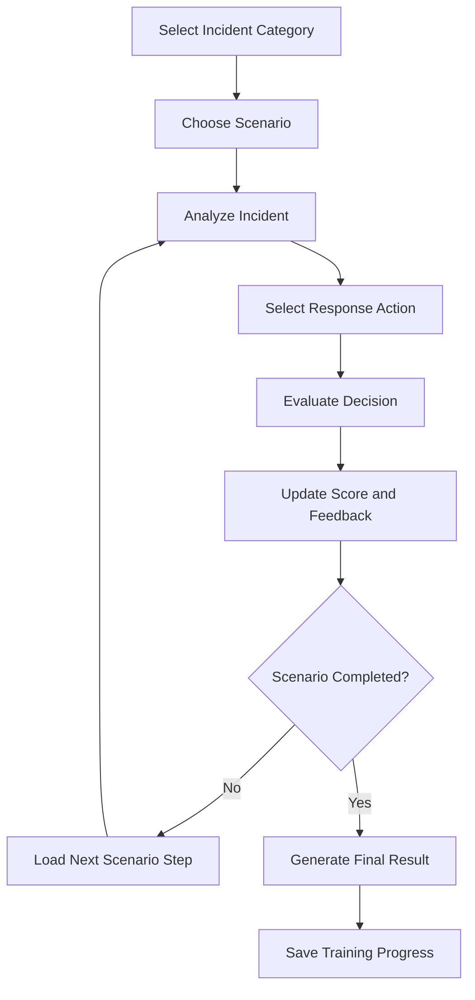
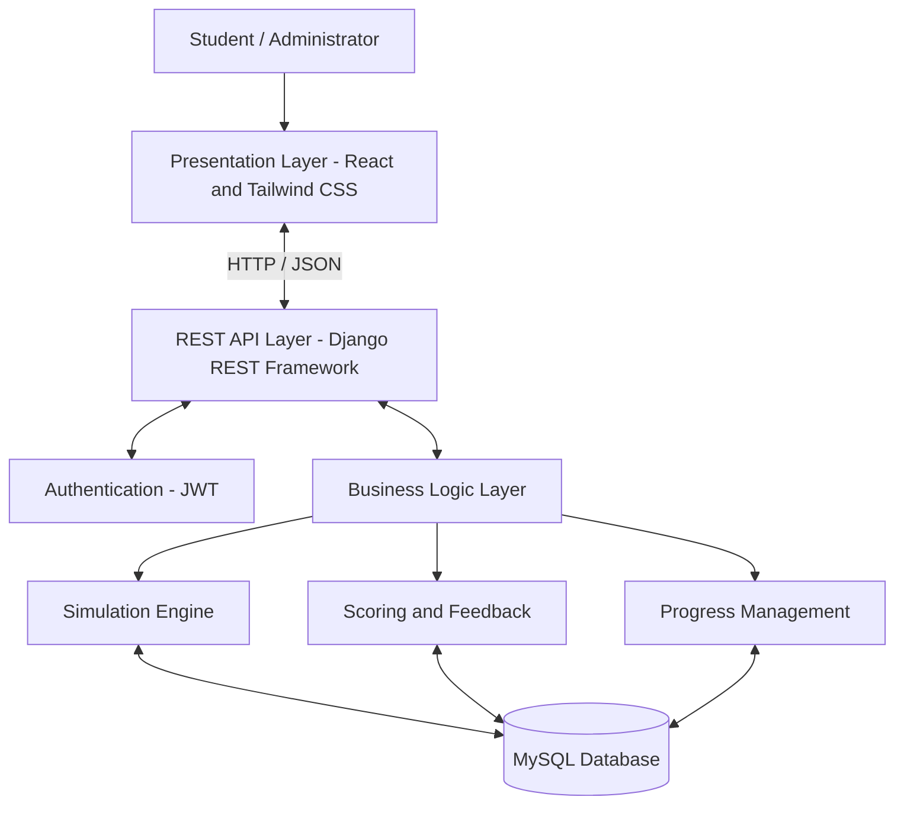

<div align="center">

# 🛡️ Guardelio

### Web-Based Security Incident Training & Simulation System

**Analyze. Respond. Learn. Improve.**

An interactive cybersecurity training platform that empowers students to develop practical incident response and security decision-making skills through simulated cyber incidents.


[Overview](#-overview) •
[Features](#-key-features) •
[Architecture](#-system-architecture) •
[Installation](#-installation--setup) •
[Roadmap](#-development-roadmap)

</div>

---

## 📖 Overview

**Guardelio** is a web-based cybersecurity training and incident response simulation platform designed to bridge the gap between theoretical cybersecurity knowledge and practical decision-making.

The platform enables students to investigate simulated security incidents, evaluate potential threats, select appropriate response actions, and understand the consequences of their decisions within a safe and controlled learning environment.

Unlike traditional static quizzes, Guardelio uses **decision-based branching scenarios**, allowing the simulation to evolve according to the student's selected actions.

## 🎯 Project Objectives

- Develop practical cybersecurity incident response skills.
- Improve analytical thinking and security decision-making.
- Provide interactive, scenario-based cybersecurity education.
- Evaluate student performance through scoring and feedback.
- Enable cybersecurity training without exposure to real cyberattacks.
- Bridge the gap between academic knowledge and practical incident response.

---

## ✨ Key Features

| Feature | Description |
|---|---|
| 🔐 Authentication | User registration, login, and JWT-based authentication |
| 📊 Student Dashboard | Centralized access to training scenarios and learning progress |
| 🎮 Interactive Simulations | Decision-driven cybersecurity incident simulations |
| 🔀 Branching Scenarios | Dynamic scenario progression based on user decisions |
| 🧠 Decision Evaluation | Assessment of selected incident response actions |
| 🏆 Scoring System | Performance-based scoring and evaluation |
| 💬 Instant Feedback | Educational feedback based on response decisions |
| 📈 Progress Tracking | Monitor training performance and completed scenarios |
| 📜 Simulation History | Review previous training sessions |
| ⚙️ Admin Management | Manage users, categories, scenarios, steps, and response options |

---

## 🚨 Incident Categories

Guardelio covers six major cybersecurity incident categories.

| Category | Training Focus |
|---|---|
| 🦠 Malware Infection | Malware identification, containment, and response |
| 🎣 Phishing & Social Engineering | Suspicious communication and manipulation detection |
| 🌐 DDoS & Network Disruption | Network availability and disruption response |
| 🔓 Data Breach & Exfiltration | Unauthorized data access and information leakage |
| 👤 Insider Threats | Security risks originating within an organization |
| 🛡️ Network Intrusion | Unauthorized network access and incident investigation |

---

## 🎮 Simulation Engine

Guardelio's simulation engine delivers interactive learning through decision-based scenario progression.

Each scenario consists of:

- Incident description and context
- Investigation information
- Multiple response options
- Decision-based branching
- Score calculation
- Educational feedback
- Final performance evaluation

### Simulation Workflow



The branching mechanism enables different learning paths based on the student's decisions rather than following a fixed question sequence.

---

## 🏗️ System Architecture

Guardelio follows a layered web application architecture that separates the presentation, API, business logic, and data management responsibilities.



### Architecture Components

| Layer | Responsibility |
|---|---|
| Presentation Layer | User interface and simulation interaction |
| API Layer | Frontend and backend communication |
| Authentication Layer | Identity verification and session authentication |
| Business Logic Layer | Scenario branching, scoring, and feedback |
| Data Layer | Persistent storage of application data |

---

## 💻 Technology Stack

### Frontend

- React.js
- JavaScript
- Tailwind CSS

### Backend

- Python
- Django
- Django REST Framework
- RESTful APIs
- JSON Web Token (JWT)

### Database

- MySQL

### Development Tools

- Git
- GitHub
- npm
- Python Virtual Environment

---

## 👥 User Roles

### Student

- Register and log in.
- Explore cybersecurity incident categories.
- Participate in interactive simulations.
- Analyze incidents and select response actions.
- Receive scores and educational feedback.
- Review training history and learning progress.

### Administrator

- Manage student accounts.
- Manage incident categories.
- Create and update training scenarios.
- Configure scenario steps and response options.
- Manage simulation-related content.

---

## 🧩 Incident Response Learning Approach

Guardelio is designed around fundamental cybersecurity incident response concepts:

1. Preparation
2. Detection and analysis
3. Containment
4. Eradication
5. Recovery
6. Post-incident learning

These concepts provide an educational foundation for understanding structured incident response practices.

The platform can support future alignment with recognized cybersecurity frameworks, including:

- NIST SP 800-61
- NIST Cybersecurity Framework (CSF)
- MITRE ATT&CK
- OWASP Top 10

---

## 🚀 Installation & Setup

### Prerequisites

Ensure the following software is installed:

- Python
- Node.js
- npm
- MySQL Server
- Git

### 1. Clone the Repository

```bash
git clone <YOUR_REPOSITORY_URL>
cd Guardelio
```

### 2. Backend Configuration

Navigate to the backend directory:

```bash
cd backend
```

Create a virtual environment:

```bash
python -m venv venv
```

Activate the virtual environment on Windows:

```bash
venv\Scripts\activate
```

For Linux or macOS:

```bash
source venv/bin/activate
```

Install dependencies:

```bash
pip install -r requirements.txt
```

Configure the MySQL database credentials and required environment variables according to the Django project settings.

Apply database migrations:

```bash
python manage.py migrate
```

Start the backend server:

```bash
python manage.py runserver
```

Backend URL:

```text
http://127.0.0.1:8000/
```

### 3. Frontend Configuration

Open a separate terminal:

```bash
cd frontend
npm install
npm run dev
```

Open the frontend URL displayed in the terminal.

> Use the start command defined in package.json if the project uses a different frontend configuration.

---

## 📁 Project Structure

The following represents a typical project structure.

```text
Guardelio/
│
├── frontend/
│   ├── public/
│   ├── src/
│   ├── package.json
│   └── ...
│
├── backend/
│   ├── manage.py
│   ├── requirements.txt
│   └── ...
│
├── README.md
└── ...
```

---

## 📸 Application Screenshots

<!-- Add actual application screenshots here.

Suggested screenshots:

- Landing Page
- Authentication Page
- Student Dashboard
- Incident Categories
- Scenario Selection
- Interactive Simulation
- Performance Results
- Admin Dashboard

Example:


-->

---

## 🔒 Security Considerations

Guardelio uses JWT-based authentication and provides a controlled environment for cybersecurity education.

Recommended security practices for development and deployment include:

- Secure password hashing
- Server-side authorization
- Input validation
- Protected API endpoints
- Environment-based secret management
- Restricted administrative access
- Secure database configuration
- HTTPS in production

Never commit database credentials, secret keys, access tokens, or sensitive environment files to the repository.

---

## 📚 Learning Outcomes

After completing training scenarios, students should be able to:

- Recognize common cybersecurity incidents.
- Analyze suspicious activities and potential threats.
- Evaluate incident response alternatives.
- Select appropriate containment and recovery actions.
- Understand the consequences of incorrect decisions.
- Improve cybersecurity awareness and response readiness.

---

## 🗺️ Development Roadmap

### Core Platform

- [x] User authentication
- [x] Student dashboard
- [x] Incident categories
- [x] Interactive simulations
- [x] Decision-based branching
- [x] Scoring and feedback
- [x] Progress tracking
- [x] Admin management

### Future Enhancements

- [ ] Advanced performance analytics
- [ ] Difficulty-based training paths
- [ ] OWASP Top 10 training scenarios
- [ ] MITRE ATT&CK technique mapping
- [ ] AI-assisted incident feedback
- [ ] Adaptive learning recommendations
- [ ] Gamification and achievement badges
- [ ] Simulated SOC environment
- [ ] Cybersecurity log analysis exercises
- [ ] Advanced incident investigation labs
- [ ] Docker-based deployment
- [ ] Automated testing and CI/CD pipelines

---

## 🤝 Contributing

Contributions, suggestions, and improvements are welcome.

1. Fork the repository.
2. Create a feature branch.
3. Implement your changes.
4. Commit your changes.
5. Push the branch.
6. Submit a pull request.

```bash
git checkout -b feature/new-feature
git add .
git commit -m "feat: add new feature"
git push origin feature/new-feature
```

---

## 🎓 Academic Project

Guardelio is developed as a Final Year Project focused on cybersecurity education, incident response training, and interactive simulation-based learning.

**Project Domain:** Cybersecurity

**Project Type:** Full-Stack Web Application

**Target Audience:** Students and cybersecurity learners

---

## ⚠️ Disclaimer

Guardelio is developed exclusively for educational and cybersecurity awareness purposes.

All incidents are simulated within a controlled learning environment. The platform is not intended to replace a production Security Operations Center (SOC), real-world incident response tools, or professional cybersecurity services.

---

<div align="center">

### 🛡️ Guardelio

**Building Cybersecurity Skills Through Simulation.**

⭐ Star this repository if you find the project useful.

</div>
